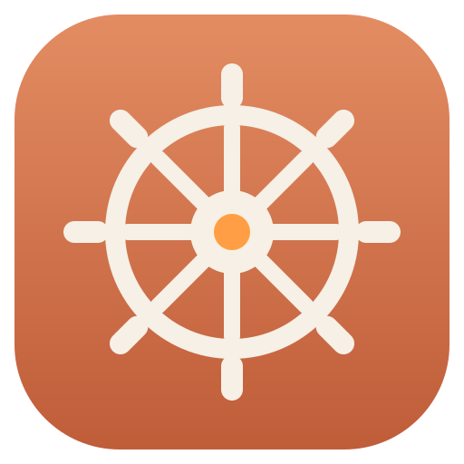
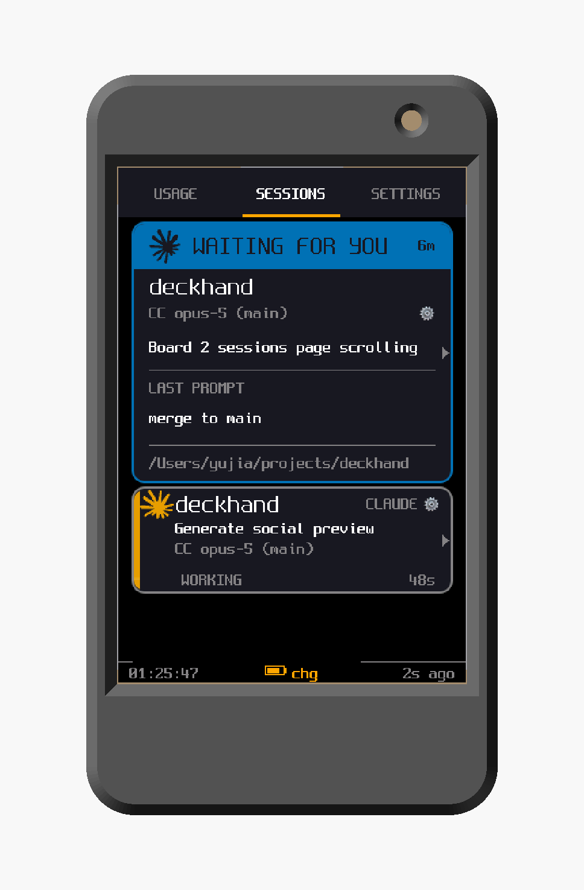
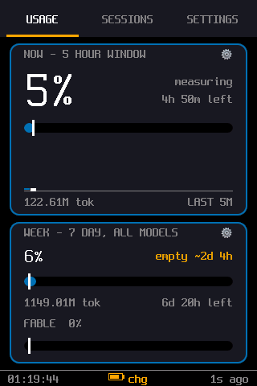
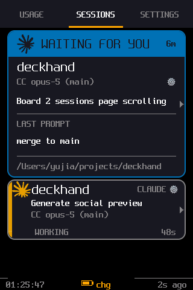
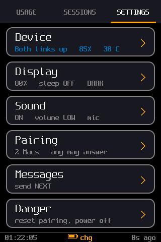
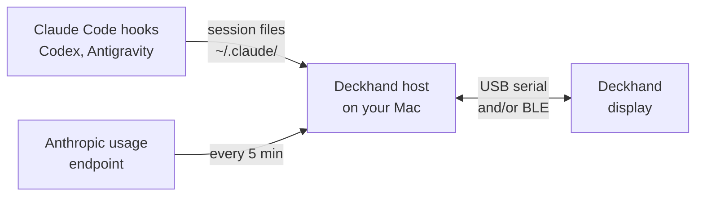

<p align="center"></p>

<h1 align="center">Deckhand</h1>

<p align="center">
  <strong>A little desk display and remote for Claude Code</strong><br>
  the crew member who keeps lookout and relays your orders
</p>

<p align="center">
  <a href="https://github.com/blueandhack/deckhand/releases"></a>
  <a href="https://github.com/blueandhack/deckhand/releases"></a>
  <a href="LICENSE"></a>
  <a href="https://github.com/blueandhack/deckhand/stargazers"></a>
  <a href="https://github.com/blueandhack/deckhand/network/members"></a>
  <a href="https://github.com/blueandhack/deckhand/commits/main"></a>
  <a href="https://github.com/blueandhack/deckhand/pulse"></a>
  <br>
  
  
  <a href="https://claude.com/claude-code"></a>
  
  
  
  
  <br>
  <a href="https://github.com/blueandhack/deckhand/issues"></a>
  <a href="https://github.com/blueandhack/deckhand/discussions"></a>
  <a href="#contributing"></a>
  
</p>

<p align="center">
  
</p>

<p align="center">
  
  
  
  <br>
  <sub>USAGE, SESSIONS and SETTINGS on board 2 (320x480, dark theme). These are real captures
  read back off the device, not mockups, and the case above is rendered from the OpenSCAD model
  with one of them composited into its window (<code>case/render-hero.py --board 2</code>).</sub>
</p>

---

Deckhand sits on your desk and watches Claude Code for you. It shows how much of your plan you
have used, lists what every session is doing, and **beeps when one needs you**. When Claude
asks for permission, asks a question or wants a plan approved, you can read it *and answer it*
from across the room by tapping, typing on the device's keyboard or **speaking**. The dialog
stays on your Mac too, so you can still answer it there.

## Features

- **Live plan usage.** 5-hour and 7-day quota, with a pace tick showing whether you are burning
  it faster than the clock, a projection of when it runs out, and a page for each Claude account
  you use.
- **Every session at a glance.** One row per project, ranked by how much it needs you: NEEDS
  INPUT, READY or WORKING, with the model, the git branch and how long it has been that way.
- **Answer from the device.** Permission prompts, questions and plan approvals, by tap, keyboard
  or voice (dictation is transcribed on your Mac by whisper). Answers are signed, so only a paired
  device can approve anything. See [Security](docs/guide/security.md).
- **Read the whole conversation.** A session's full transcript is readable on the device (paged
  on board 1, scrolling on board 2). On board 2 a PROJECTS tab lists past sessions for each
  project too.
- **More than Claude Code.** **Codex** threads join the same list and can be answered the same
  way. **Antigravity** sessions and usage appear as well (view only).
- **Two Macs, two boards.** One device can pair with more than one Mac, and one Mac can drive
  two boards at once, over USB and Bluetooth LE at the same time.
- **A menu-bar app** with the same information on the Mac, plus setup, pairing and updates.
- **Runs on battery** with a battery level that is honest about being an estimate, and
  sleeps when you walk away.

## Hardware

Deckhand runs on two off-the-shelf ESP32 touchscreen boards. One source tree builds both, and
the build target picks the board.

| | board 1 | board 2 |
|---|---|---|
| module | ELEGOO **E32R28T** / E32N28T | LCDwiki **ES3C35P** |
| chip and screen | ESP32, 2.8" 240x320 | ESP32-S3, 3.5" 320x480 |
| touch | resistive (one-time calibration) | capacitive |
| microphone and beeper | add-on MAX4466 mic and 1W speaker | on board (ES8311 codec) |
| flash it | `./flash.sh` | `./flash.sh --board 2` |
| case | [`case/`](case/) | [`case/`](case/README-board2.md) |

A LiPo battery is optional on both. Parts list, wiring and what each board can and cannot do:
**[Hardware](docs/guide/hardware.md)**.

## Getting started

### 1. The Mac app (alpha)

Download **[Deckhand.app from Releases](https://github.com/blueandhack/deckhand/releases)**.
It is a notarized Mac app with the menu bar, the host and its own Node built in, so you need no
Node, no Homebrew and no clone of this repo. It needs Apple Silicon and macOS 14 or later, and
it updates itself through Sparkle.

Open the DMG, drag Deckhand to **Applications**, open it, and follow the setup window. It asks
before it changes Claude Code's settings, takes a backup first, and asks macOS for Bluetooth
once.

> **Alpha:** it has been tested end to end on the machine it was built on. Each release's notes
> list what has not been verified yet.

### 2. Flash the board

Firmware is flashed from a clone of this repo. You need
[arduino-cli](https://arduino.github.io/arduino-cli/) and the ESP32 core.

```sh
git clone https://github.com/blueandhack/deckhand.git && cd deckhand
./flash.sh             # board 1
./flash.sh --board 2   # board 2
```

`flash.sh` compiles, finds the serial port, pauses the running host so the port is free,
uploads, and starts the host again afterwards. A compile takes about three minutes.

### Or: run everything from source

If you would rather not use the app, you need [Node.js](https://nodejs.org)
(`brew install node`), arduino-cli and Claude Code:

```sh
./install.sh
```

`install.sh` backs up any existing Deckhand state to `~/Deckhand-backups`, installs the Claude
Code hooks into `~/.claude/` (merging with your existing `settings.json`, never replacing it),
runs `npm install`, and builds `DeckhandBLE.app` from your Node. **Restart Claude Code
afterwards** so it picks up the hooks. `./uninstall.sh` takes Deckhand back out of
`~/.claude` (it keeps your backups, and `--dry-run` shows what it would do first).

Full walk-through: **[Setup](docs/guide/install-and-uninstall.md)**.

## How it works



Hooks in Claude Code (and Codex and Antigravity) write each session's state to small files in
`~/.claude/`. The host on your Mac reads them every few seconds, polls your plan usage, and
streams both to the device over USB and Bluetooth LE at once. Answers travel back the same way
and are checked against a key shared when you paired. More: **[How it works](docs/guide/how-it-works.md)**.

## Documentation

| you are | start here |
|---|---|
| **setting it up or building one** | [`docs/guide/`](docs/guide/): [overview](docs/guide/overview.md) · [hardware](docs/guide/hardware.md) · [setup](docs/guide/install-and-uninstall.md) · [controls](docs/guide/controls.md) · [answering](docs/guide/answering.md) · [voice](docs/guide/voice.md) · [security](docs/guide/security.md) · [menu bar](docs/guide/menu-bar.md) · [Codex](docs/guide/codex.md) · [how it works](docs/guide/how-it-works.md) · [known limitations](docs/guide/known-limitations.md) |
| **changing the code** (person or AI agent) | [`CLAUDE.md`](CLAUDE.md) first. It holds the rules, and it says which [`docs/reference/`](docs/reference/) file to read before touching what |

## Project layout

```
firmware/deckhand_display/   the Arduino sketch: one source tree, both boards
  board.h, board_*.h         board selection; every pin and layout constant lives here
  *-check.mjs                offline checkers for layout and protocol, no hardware needed
firmware/tft_setup/          TFT_eSPI pin map (board 1 only)
host/                        the Node host that runs on your Mac (index.mjs), plus its checkers
claude-hooks/                hook scripts for Claude Code, Codex and Antigravity, and their installers
mac-app/                     the menu-bar app (Swift)
release/                     building, notarizing and publishing Deckhand.app and its update feed
case/                        OpenSCAD cases for both boards, ready-to-print STLs, the hero renderer
docs/                        guide/ for people, reference/ for whoever changes the code, design/ mocks
flash.sh, install.sh, uninstall.sh
```

## Known limitations

The main ones, in short. The full list is in
**[Known limitations](docs/guide/known-limitations.md)**.

- **Up to ~5 seconds of lag.** The host polls rather than being pushed to, and the footer shows
  how old the data is.
- **Remote answers have a 90-second window** per prompt, and multi-select questions must be
  answered on the Mac.
- **The usage endpoint is undocumented.** It is the one `/usage` uses. If it changes, the host
  falls back to the statusLine cache, and stale numbers are flagged on screen rather than hidden.
- **Battery percentage is an estimate** from voltage, and "off" is deep sleep (a few mA), not a
  hard power cut.
- **Board 2 cannot wake from deep sleep on a touch.** That is a limit of the ESP32-S3's wake pins.
  So it powers itself off only after two hours idle on battery, and RESET wakes it.

## Contributing

Issues and pull requests are welcome. There is no unit test suite. A change is verified by
compiling, flashing, watching the log and looking at the screen, plus a set of offline checkers
(`node firmware/deckhand_display/*-check.mjs`, `node host/*-check.mjs`). **Read
[`CLAUDE.md`](CLAUDE.md) before changing firmware.** It lists the rules that have cost real
debugging time, such as never compiling both boards at once and keeping on-device text to plain
ASCII.

## License

[MIT](LICENSE). Third-party licenses are in [`licenses/`](licenses/).

---

<p align="center"><sub><em>Rumor has it something small and orange lives beneath the footer.</em></sub></p>
